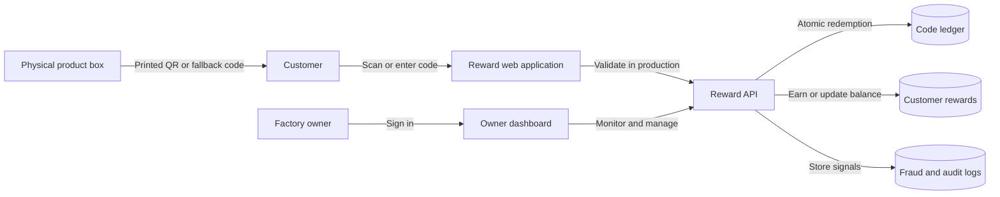

# Architecture

## Stack choice

- **React and TypeScript:** Component-based UI, strong types, and broad tooling support make it suitable for a responsive operations dashboard.
- **Vite:** Fast development and a simple static production build suit a front-end prototype and allow deployment on common static hosts.
- **CSS:** The project does not require a large design-system dependency for this prototype, so native CSS keeps the implementation lightweight and clear.
- **Lucide React:** Provides consistent, accessible interface icons without maintaining custom icon assets.
- **Vitest and React Testing Library:** Lightweight browser-like component tests verify visible behavior and interactions.

## System context

The submitted implementation is the left-side prototype of this architecture: it provides the owner dashboard and interaction states, while the API, transaction database, QR print service, and authentication provider are represented conceptually.

## Data model

### Customer

| Field | Type | Purpose |
|---|---|---|
| id | string | Stable customer identifier |
| name | string | Display name |
| email | string | Account contact and support lookup |
| pointsBalance | integer | Available points |
| status | enum | Active, suspended, or closed |

### ProductCode

| Field | Type | Purpose |
|---|---|---|
| id | string | Public or hashed code identifier |
| codeHash | string | One-way code representation |
| productSku | string | Associated product/box type |
| batchId | string | Factory production batch |
| status | enum | Issued, redeemed, blocked, or expired |
| redeemedByCustomerId | string or null | Account receiving points |
| redeemedAt | timestamp or null | Redemption time |

### Reward

| Field | Type | Purpose |
|---|---|---|
| id | string | Stable reward identifier |
| name | string | Customer-facing name |
| pointsRequired | integer | Redemption cost |
| type | enum | Physical product, store credit, or free shipping |
| description | string | Reward terms |
| status | enum | Draft or active |

### Redemption

| Field | Type | Purpose |
|---|---|---|
| id | string | Public redemption reference |
| customerId | string | Redeeming customer |
| codeId | string | Redeemed unique box code |
| rewardId | string | Redeemed reward, where applicable |
| pointsDelta | integer | Points added or deducted |
| status | enum | Approved, pending, flagged, or rejected |
| createdAt | timestamp | Audit timestamp |

### FraudSignal

| Field | Type | Purpose |
|---|---|---|
| id | string | Signal identifier |
| redemptionId | string | Associated redemption |
| rule | string | Triggered rule |
| severity | enum | Low, medium, or high |
| action | enum | Allow, review, or block |

## Production security and reliability

1. Generate unpredictable codes with a cryptographic random source and print either the code or a signed QR payload.
2. Store only a salted or keyed hash of the code. Never use a database primary key or reusable code as a transferable secret alone.
3. Redeem within a database transaction using an idempotency key. A code transition to `redeemed` must occur exactly once.
4. Sign in customers and enforce role-based access for factory staff.
5. Apply rate limits, one-time redemption rules, geolocation and velocity signals, and manual review queues.
6. Append immutable audit records for code generation, reward creation, redemption, approval, rejection, and configuration changes.
